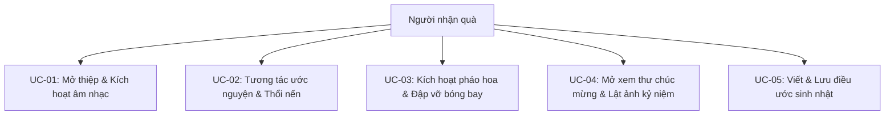
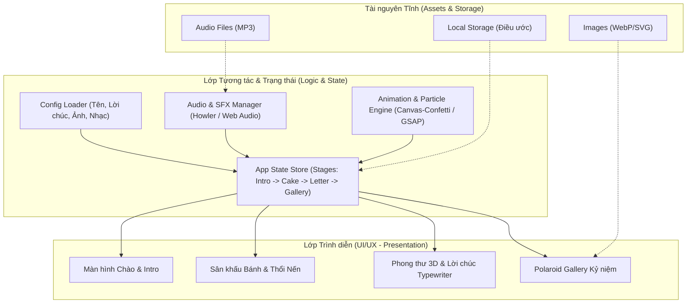

# Phân Tích & Đặc Tả Kỹ Thuật (Analysis & Specification)
## Dự án: Birthday Celebration Interactive Web (CMSN)

---

## 1. Giới thiệu & Mục tiêu (Project Brief)

- **Tên dự án**: Birthday Celebration Interactive Web
- **Mục tiêu**: Tạo trang web chúc mừng sinh nhật giàu cảm xúc, có tính tương tác cao (thổi nến, mở thiệp, bắn pháo hoa, lật ảnh kỷ niệm, phát nhạc nền), giao diện hiện đại mang tính cá nhân hoá, hoàn toàn chạy Client-side (Static Web, không cần backend/database).
- **Đối tượng sử dụng**: Người nhận quà sinh nhật và người gửi tặng quà (muốn cá nhân hóa tên, lời chúc, danh sách ảnh).

---

## 2. Phân rã chức năng (Functional Decomposition)

Hệ thống được phân rã thành **4 phân hệ chính** với **18 hàm nguyên tử (Atomic Functions)**:

```
CMSN (Birthday Web)
├── Subsystem 1: Trải nghiệm Mở đầu & Âm nhạc (Welcome & Audio)
│   ├── F1.1: Màn hình chào đếm ngược / Cửa mở (Curtain/Gate Reveal)
│   ├── F1.2: Kích hoạt Audio Player (Play/Pause background music)
│   ├── F1.3: Quản lý trạng thái âm thanh & Sound FX (Pop, Sparkle, Blow)
│   └── F1.4: Bộ điều khiển Volume & Mute trên màn hình
├── Subsystem 2: Tương tác Sinh nhật (Birthday Interactive Elements)
│   ├── F2.1: Bánh sinh nhật 3D/Vector với nến lung linh
│   ├── F2.2: Tương tác Thổi nến (Click / Micro / Hold to Blow out)
│   ├── F2.3: Hiệu ứng Khói bay sau khi nến tắt
│   ├── F2.4: Bắn Confetti / Pháo hoa mừng sinh nhật (Canvas Confetti Engine)
│   └── F2.5: Bóng bay bay lơ lửng & Tương tác click làm nổ bóng (Balloon Pop)
├── Subsystem 3: Thiệp chúc mừng & Kỷ niệm (Wish Card & Polaroid Gallery)
│   ├── F3.1: Hiệu ứng mở phong bì thư 3D (Envelope Unfold Animation)
│   ├── F3.2: Hiển thị thư viết tay với hiệu ứng gõ chữ (Typewriter Effect)
│   ├── F3.3: Bộ sưu tập ảnh Polaroid dạng kéo thả / lật thẻ (Draggable/Flip Photos)
│   ├── F3.4: Hộp điều ước cá nhân (Make a Wish Box - Lưu localStorage)
│   └── F3.5: Cây thông điệp / Hạc giấy gửi lời chúc
└── Subsystem 4: Cá nhân hóa & Cấu hình (Config & Personalization Engine)
    ├── F4.1: Parser file cấu hình nội dung (`config.json` hoặc URL params)
    ├── F4.2: Tùy biến thông tin người nhận (Tên, ngày sinh, lời chúc riêng)
    ├── F4.3: Tùy biến bộ sưu tập ảnh và bài hát
    └── F4.4: Theme switcher / Hiệu ứng ánh sáng lung linh (Starfield / Bokeh)
```

**Tổng số hàm nguyên tử (Atomic Leaf Functions)**: **18 functions**.

---

## 3. Ca sử dụng chính (Use Cases)



---

## 4. Kiến trúc hệ thống (System Architecture)

### 4.1 Kiến trúc tổng thể: Client-Side Jamstack / Standalone SPA

Trang web hoạt động độc lập, không yêu cầu cơ sở dữ liệu máy chủ. Toàn bộ tài nguyên (âm thanh, hình ảnh, văn bản) được nạp trực tiếp hoặc qua file cấu hình tĩnh.



---

## 5. Mô hình Dữ liệu (State & Config Model)

Vì không dùng Database máy chủ, dữ liệu được định nghĩa dưới dạng JSON cấu hình (`config.js` hoặc `data/config.json`) và trạng thái runtime:

```typescript
interface BirthdayConfig {
  recipientName: string;         // Tên người nhận (vd: "Thảo Vy")
  birthDate: string;             // Ngày sinh (vd: "2000-10-10")
  title: string;                 // Tiêu đề chính
  subtitle: string;              // Phụ đề
  music: {
    src: string;                 // Đường dẫn bài hát nền
    title: string;
    autoplayAfterIntro: boolean;
  };
  letter: {
    salutation: string;          // Lời chào mở đầu
    paragraphs: string[];        // Nội dung từng đoạn thư
    closing: string;             // Lời kết & Ký tên
  };
  photos: Array<{
    src: string;
    caption: string;
    rotation?: number;           // Góc xoay polaroid ngẫu nhiên
  }>;
  candlesCount: number;          // Số nến trên bánh
}

interface AppRuntimeState {
  currentStage: 'intro' | 'cake' | 'letter' | 'gallery' | 'finale';
  isMusicPlaying: boolean;
  isCandlesBlown: boolean;
  userWish: string | null;
  balloonsPopped: number;
}
```

---

## 6. Đề xuất Công nghệ (Tech Stack Options)

| Tiêu chí | **Lựa chọn 1 (Khuyên dùng): Vite + Vanilla JS + GSAP + Canvas-Confetti** | **Lựa chọn 2: Vite + React + Framer Motion + Canvas-Confetti** | **Lựa chọn 3: Single-file HTML/CSS/JS thuần (Zero-build)** |
|:---|:---|:---|:---|
| **Ưu điểm** | Siêu nhẹ (<100KB), hiệu năng animation 60fps mượt mà nhất với GSAP, dễ tuỳ biến, deploy lên GitHub Pages/Vercel trong 5 giây. | Quản lý state theo component rõ ràng, hệ sinh thái Framer Motion mạnh cho declarative UI. | Không cần cài đặt Node.js/npm, chỉ cần click đúp mở trực tiếp file `index.html`. |
| **Nhược điểm** | Quản lý component bằng DOM thuần nếu dự án phình to. | Bundle size lớn hơn, overhead cho trang web tĩnh đơn giản. | Khó bảo trì animations phức tạp, không tận dụng được HMR và bundler hiện đại. |
| **Phù hợp** | Trang web tương tác giàu animation, mượt mà, tối ưu nhất. | Đội ngũ quen thuộc với React framework. | Muốn gửi nhanh qua Zalo/email dưới dạng 1 file nén. |

---

## 7. Thiết kế UI/UX & Phong cách Thẩm mỹ (Impeccable Design Guidelines)

- **Chế độ**: `Experience Mode` (Tập trung vào cảm xúc, sự bất ngờ, niềm vui và sự ấm áp).
- **Typography**: 
  - Display Font: `Playwrite VN` hoặc `Caveat` (font chữ viết tay thanh lịch, ấm áp).
  - Body Font: `Plus Jakarta Sans` hoặc `Outfit` (sạch sẽ, tương phản cao, hiện đại).
- **Bảng màu (Color Palette)**:
  - Nền đêm kỳ diệu: `#0b0f19` (Deep Midnight Blue) kết hợp ánh sáng ấm `#fef3c7` (Candle Glow).
  - Điểm nhấn cảm xúc: `#ec4899` (Rose Gold Pink) & `#f59e0b` (Warm Amber).
- **Âm thanh tương tác**:
  - Tiếng pháo giấy (Confetti pop), tiếng nổ bóng (Balloon pop), tiếng quẹt diêm/thổi nến (Candle blow).
